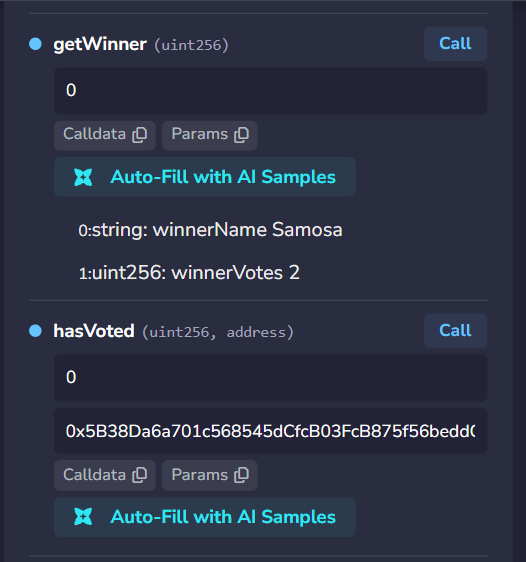
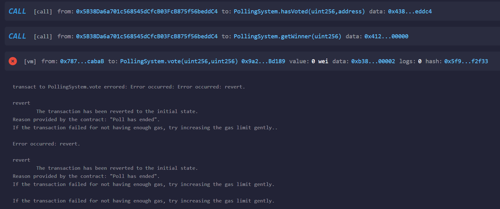
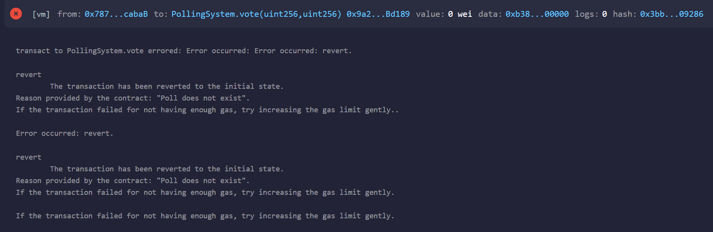
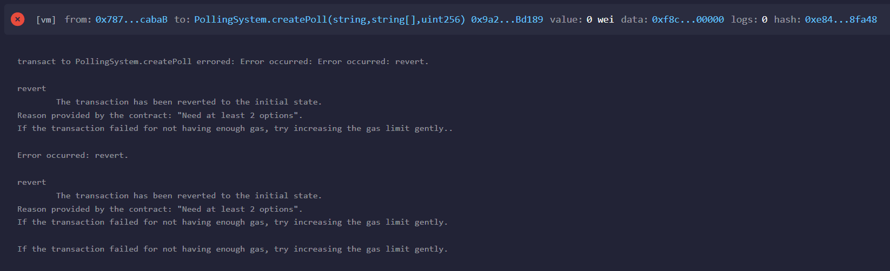

# CodeAlpha_PollingSystem

Task 3 of the CodeAlpha Blockchain Development Internship.

## What it does
A Solidity smart contract that lets anyone create a poll, vote once per address before the deadline, and find the winner after the poll ends.
- `createPoll(title, options, durationInSeconds)`: creates a poll with at least 2 options and an end time
- `vote(pollId, optionIndex)`: one vote per address, only before the deadline
- `getPoll(pollId)`: returns the title, options and end time
- `getVotes(pollId, optionIndex)`: returns the vote count of an option
- `getWinner(pollId)`: returns the winning option and its votes, only after the poll has ended
- `hasVoted(pollId, address)`: shows whether an address has already voted
- Poll data and votes are stored with a struct and mappings; ties go to the earliest option, and a poll with no votes has no winner
- `PollCreated` and `Voted` events are emitted

## How to run (Remix IDE)
1. Open https://remix.ethereum.org
2. Create `PollingSystem.sol` and paste the code from `/contracts`
3. Compile with Solidity 0.8.20 or newer
4. Deploy using the Remix VM environment
5. Call `createPoll` with title `"Best snack"`, options `["Singara","Samosa","Chaat"]` and duration `180`
6. Switch between accounts and call `vote` with `0` and an option index (0, 1 or 2)
7. After 3 minutes, call `getWinner` with `0`

## Test results
| Action | Expected | Result |
|---|---|---|
| Create poll "Best snack" with 3 options | Poll ID 0, `pollCount` is 1 | Pass |
| Account 1 and 2 vote Samosa, Account 3 votes Singara | Samosa 2 votes, Singara 1 vote | Pass |
| Account 1 votes again | Revert: "Already voted" | Pass |
| Vote after the deadline | Revert: "Poll has ended" | Pass |
| `getWinner` after the deadline | Samosa with 2 votes | Pass |
| Vote on poll that does not exist | Revert: "Poll does not exist" | Pass |
| Create poll with 1 option | Revert: "Need at least 2 options" | Pass |

## Screenshots

## Concepts demonstrated
Structs, mappings, nested mappings, arrays of strings, `block.timestamp` for time-based rules, one-vote-per-address enforcement, `view` functions, finding a maximum with a loop, `require()` validation, events.
